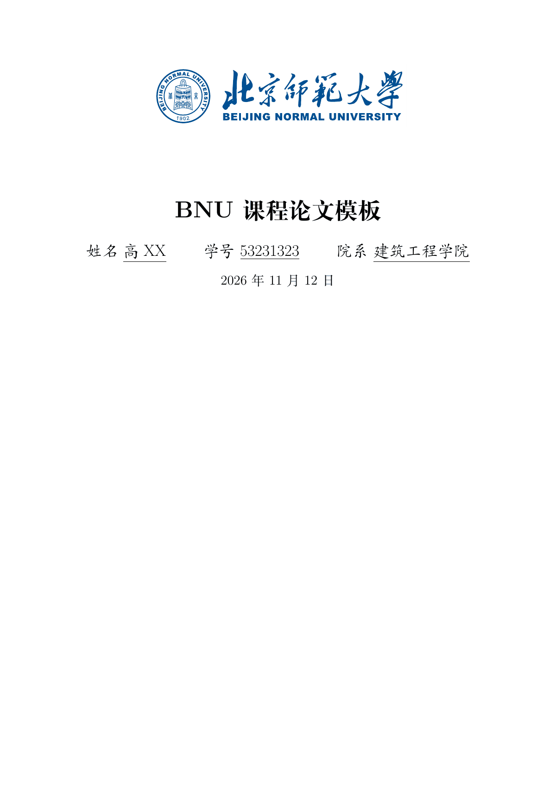
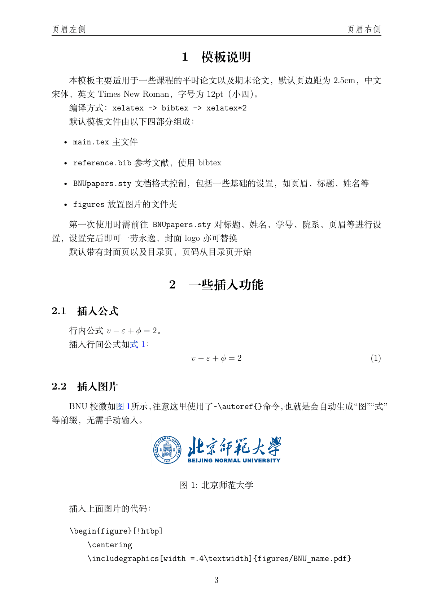
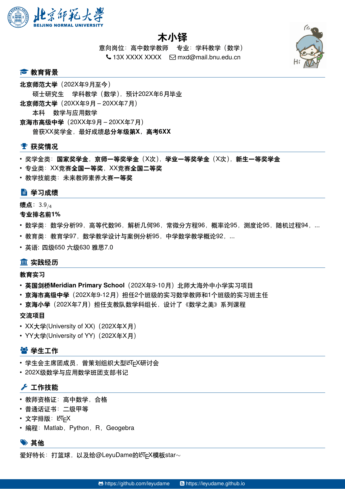
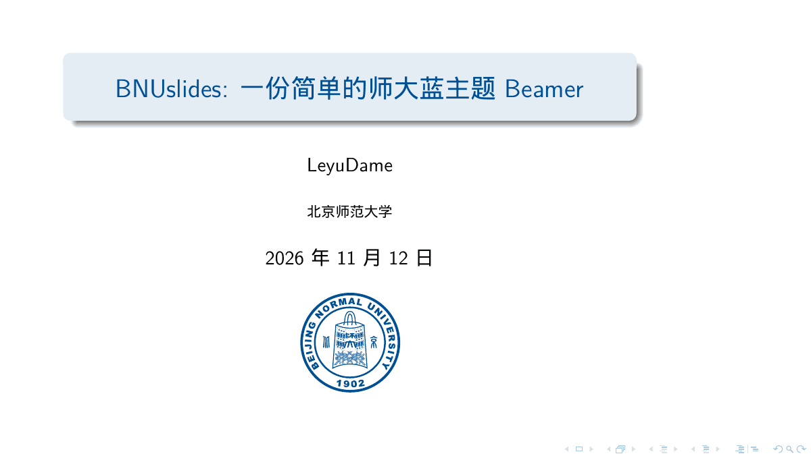
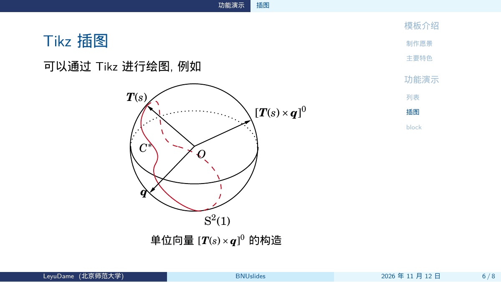
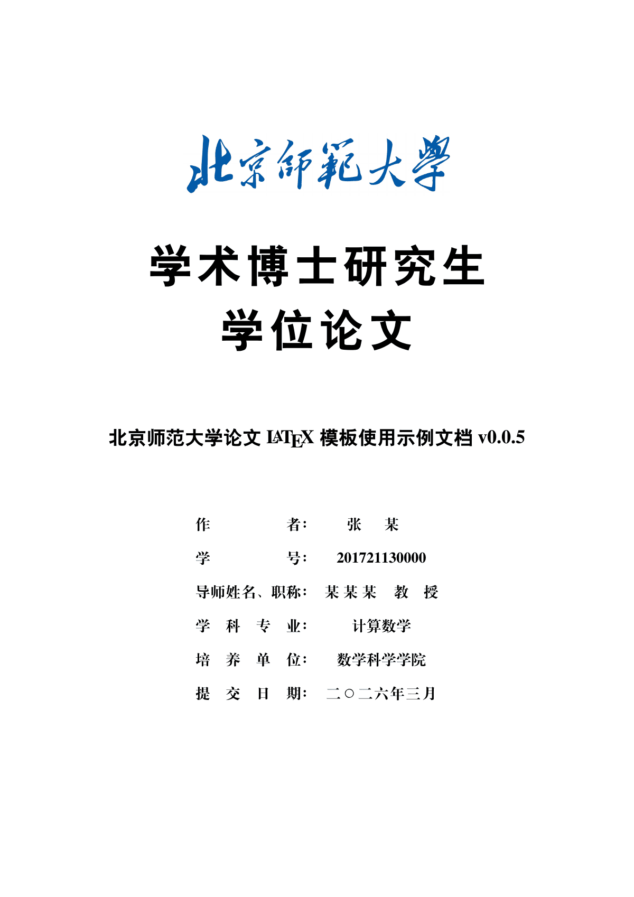
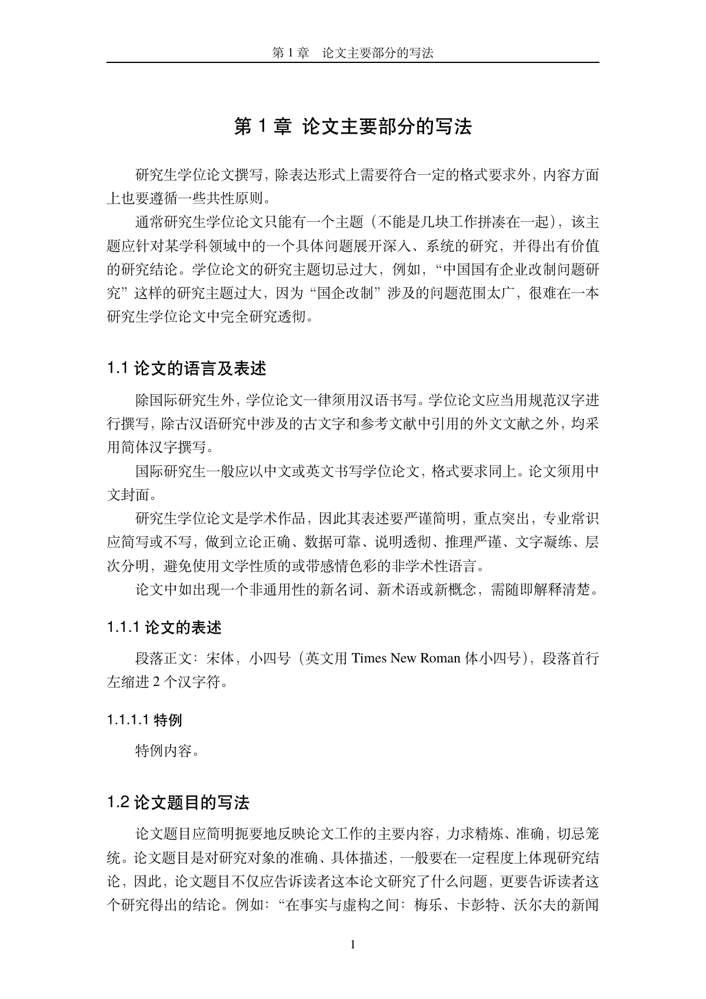

# 北京师范大学 LaTeX 模板合集

非官方课程论文、简历、幻灯片与研究生学位论文模板，使用 XeLaTeX。

## 模板

| 模板 | 说明 | 预览 |
| --- | --- | --- |
| [课程论文](templates/paper) | `ctexart`，BibTeX |   |
| [简历](templates/cv) | XeLaTeX，基于 [myCV](https://github.com/Htallone/myCV) |  |
| [幻灯片](templates/slides) | `bnuslides`，侧栏参考 [zbowang/BeamerTheme](https://github.com/zbowang/BeamerTheme) |   |
| [学位论文](templates/thesis) | bnuthesis v0.0.5（2026-03-01） |   |

## 快速开始

### Overleaf

上传对应的 `templates/` 子目录，编译器选 XeLaTeX。

### 本地

安装 TeX Live 后，在仓库根目录执行 `make all`，或进入子目录执行下面的命令。

## 编译

```bash
cd templates/paper  && latexmk -xelatex main.tex
cd templates/cv     && latexmk -xelatex main.tex
cd templates/slides && latexmk -xelatex main.tex
cd templates/thesis && latexmk bnuthesis-example.tex && latexmk spine.tex
```

论文和幻灯片的编译顺序是 `xelatex`、`bibtex`、`xelatex`、`xelatex`。`latexmk` 会按这个顺序处理。

## 许可证

- 论文、简历、幻灯片：LPPL-1.3c，见根目录 `LICENSE`。`BNUpapers.sty` 文件头保留原 CC BY 4.0 声明。
- 学位论文：`templates/thesis/LICENSE`（LPPL-1.3c，基于 [ThuThesis](https://github.com/tuna/thuthesis)）。
- `assets/bnu-logo`：GPL-3.0。

## 声明

本仓库与北京师范大学没有隶属关系，未获认可或授权。校名和校徽只用于版式演示。

This repository is unofficial. It is not affiliated with, endorsed by, or authorized by Beijing Normal University. The name and emblem are for layout demonstration only.

## 学位论文来源

官方文件见北京师范大学图书馆学位论文提交系统：<https://etdlib.bnu.edu.cn/notice/81>。官方最新版优先。本仓库只收录 2026-03-01（bnuthesis v0.0.5）的副本。

## English

Unofficial XeLaTeX templates: course paper, CV, slides, and a graduate thesis. On Overleaf, upload one directory under `templates/` and select XeLaTeX. Locally, run `make all` or the `latexmk` commands above. The templates are LPPL-1.3c; `assets/bnu-logo` is GPL-3.0. The thesis file here is the 2026-03-01 copy; the [library notice](https://etdlib.bnu.edu.cn/notice/81) is the source of later versions.
