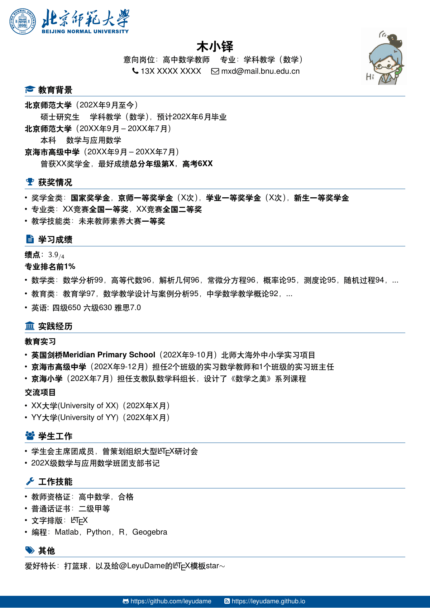

# 简历

XeLaTeX 简历。LeyuDame 改进，基于 [myCV](https://github.com/Htallone/myCV)。



英文为 TeX Gyre Heros，中文为 FandolHei，均由 TeX Live 提供。页眉校名图 `img/BNU_name.pdf` 与 `assets/bnu-logo` 相同（GPL-3.0）。

```bash
latexmk -xelatex main.tex
```

Overleaf：上传本目录，编译器选 XeLaTeX。
