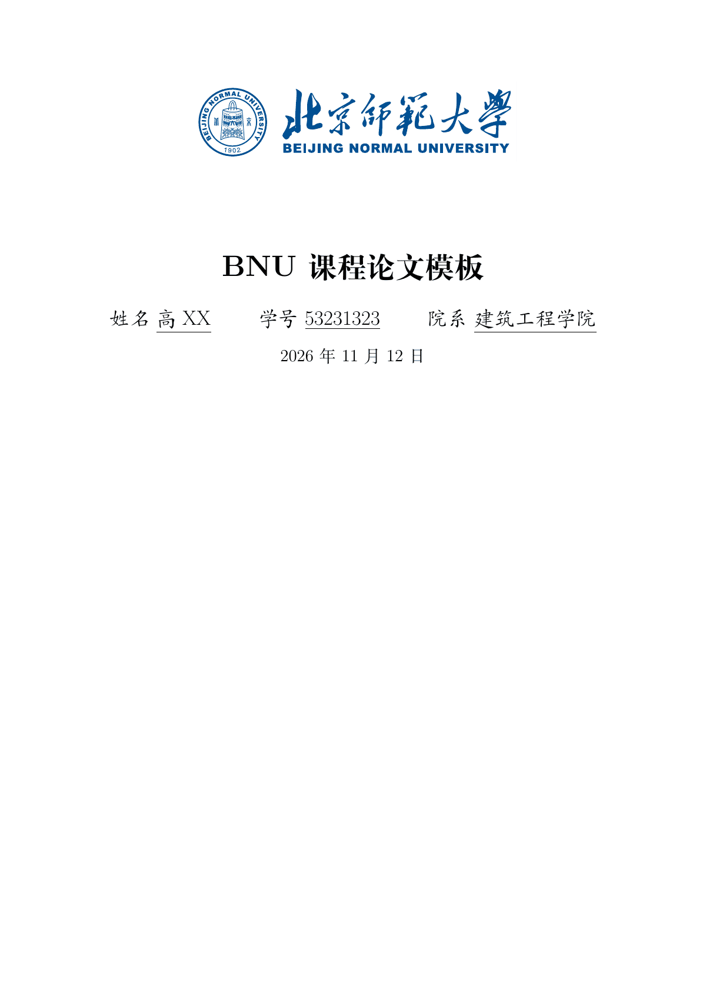
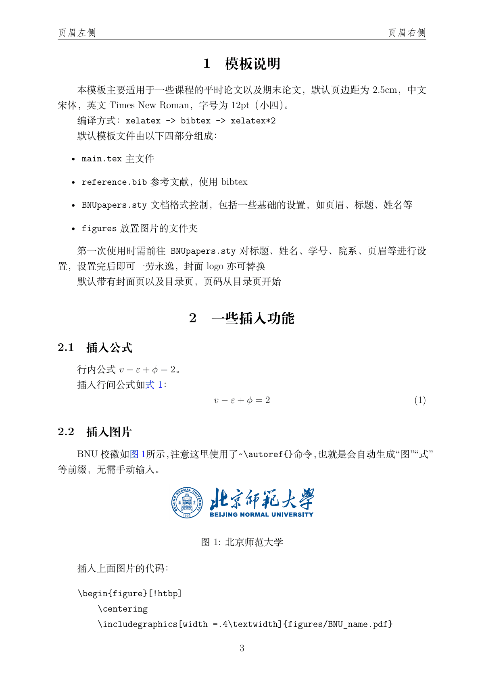

# 课程论文

`ctexart` 课程论文。基于 Shawn Wang 的北京大学课程论文模板。样式文件头保留 CC BY 4.0 声明；本合集以 LPPL-1.3c 分发。




在 `BNUpapers.sty` 中修改标题、姓名、学号、院系和页眉。参考文献写在 `reference.bib`。封面校名图 `figures/BNU_name.pdf` 与 `assets/bnu-logo` 相同（GPL-3.0）。

```bash
latexmk -xelatex main.tex
```

Overleaf：上传本目录，编译器选 XeLaTeX。
