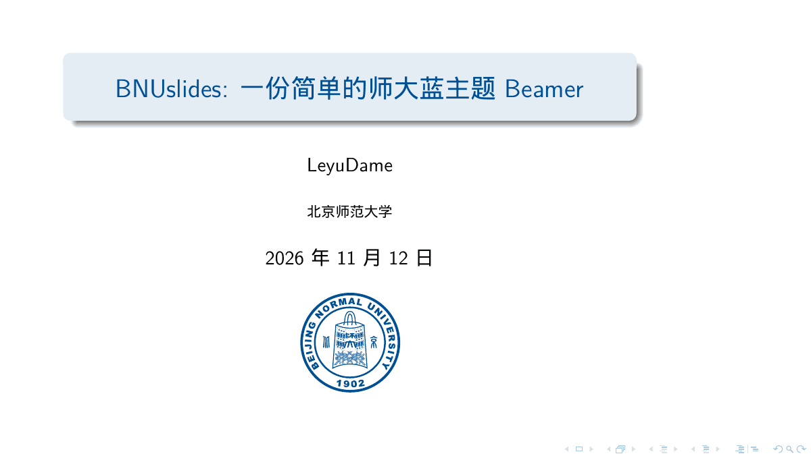
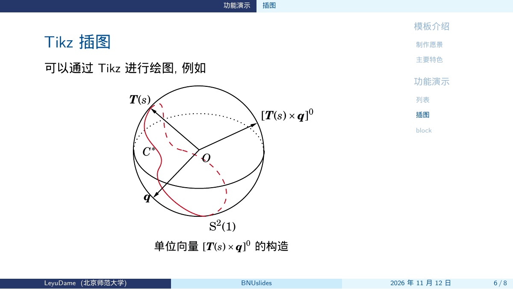

# 幻灯片

师大蓝 Beamer，文档类 `bnuslides`。取自 [BNUslides2026](https://github.com/YZDame/BNUslides2026)（含 `refs.bib`）。作者 LeyuDame。侧栏目录参考 [zbowang/BeamerTheme](https://github.com/zbowang/BeamerTheme)。




中文按 macOS、Windows、Linux 的字体依次回退，最后使用 TeX Live 的 Fandol。封面校徽为 `BNU_icon.pdf`（GPL-3.0）。引用说明见 `REFERENCES.md`。

```bash
latexmk -xelatex main.tex
```

Overleaf：上传本目录，编译器选 XeLaTeX。
