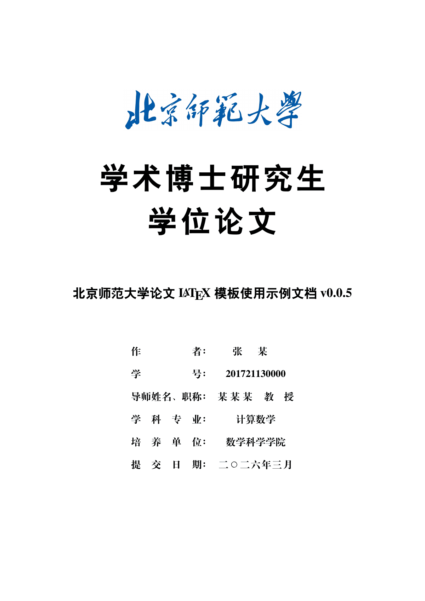
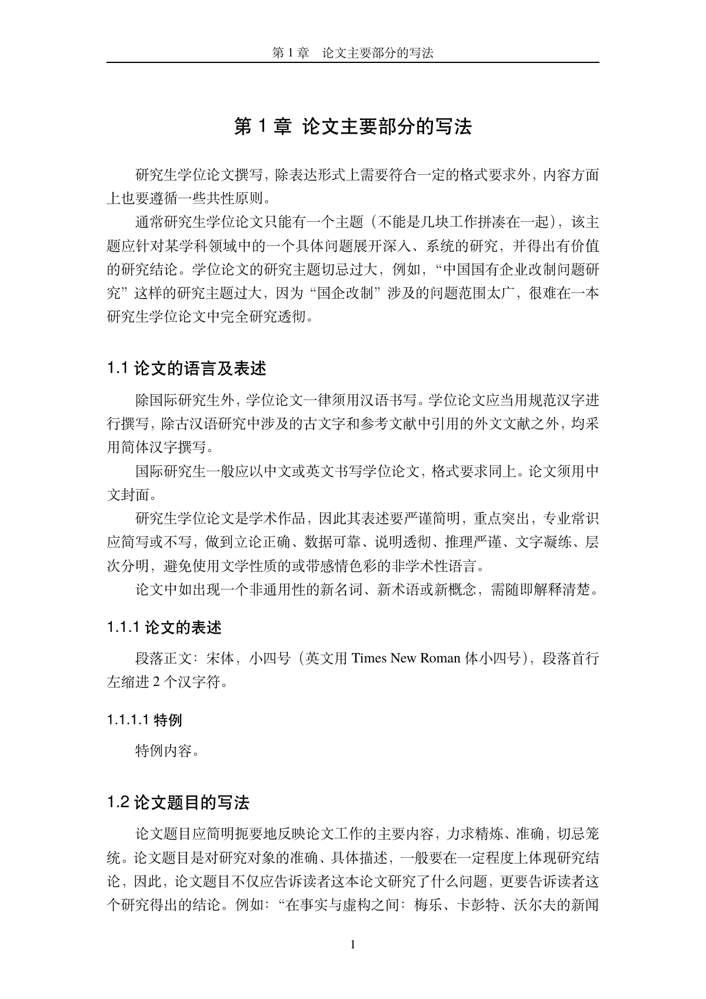

# 研究生学位论文

bnuthesis v0.0.5（2026-03-01），基于 [ThuThesis](https://github.com/tuna/thuthesis)，LPPL-1.3c（见本目录 `LICENSE`）。

官方来源：<https://etdlib.bnu.edu.cn/notice/81>。官方最新版优先于这里的 2026-03-01 副本。




`bnuthesis.cls` 已包含在目录中。`figures/` 中的校名图来自上述官方包，未改动。元数据在 `bnusetup.tex`。

```bash
latexmk bnuthesis-example.tex
latexmk spine.tex
```

Overleaf：上传本目录，主文件选 `bnuthesis-example.tex`，编译器选 XeLaTeX。
